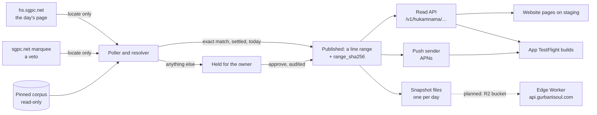

# The Hukamnama service

Every morning SGPC publishes the Hukamnama taken at Sri Harmandir Sahib, Amritsar. The Hukamnama
service (`services/hukamnama/`) finds that shabad **in the pinned corpus** and serves it as a range
of corpus lines. It is the server side of the feature the app and the website call
**"Hukamnama · Sri Harmandir Sahib"**.

It is a different thing from the app's **Hukam of the day**, which the device chooses by date from
its own corpus with no server at all. Copy, code and docs never call one by the other's name, and
nothing here is described as official: SGPC is credited as the source the service uses to locate
the day's shabad, and Gurbani Soul is not affiliated with SGPC.

This page is the shape of the whole thing. The day-to-day decisions are in
[the Hukamnama runbook](../process/runbooks/hukamnama.md); the Render service, its secrets and its
backups are in [the service runbook](../process/runbooks/hukamnama-service.md); the public API is
[the Hukamnama API](../api/hukamnama.md).

## What runs today, and what is planned

| Part | State on 2026-11-12 |
|---|---|
| The service: poller, resolver, decision store, read API, owner tools | **Running on staging**: the Render service `sggs-hukamnama-staging`, also at `api-staging.gurbanisoul.com`, deployed from `integration` by `hukamnama-deploy.yml`. There is no production service yet. |
| State backup (Litestream to R2) | In the code and the image (#378); on when the four R2 values are set on the service. |
| Push to iPhones (APNs) | In the code (#381, #382). On staging `/health` reports `push.sending: true`; a push reached a TestFlight device end to end on 2026-11-11 (gurbani-soul-ios #130). Staging only ever reaches TestFlight builds. |
| The app's side: registration, sheet, card, widget, notification service extension | Shipped in **TestFlight builds only** (gurbani-soul-ios #127, #128, #130). App Store builds compile it out until its G3 copy review and G4 privacy changes are signed ([what the app does](../ios/what-the-app-does.md#hukamnama--sri-harmandir-sahib-testflight-only)). |
| Public snapshot files | In the code (#383, #385). Writing them to an R2 bucket is **not set up** on any service yet. |
| Edge Worker (`services/hukamnama-edge`) for `api.gurbanisoul.com` | In the code and tested in CI (#384). **Not deployed**; `api.gurbanisoul.com` does not answer yet. |
| Website pages, feeds, sitemap and embed | In the code (#386–#391); routed **on staging only**, where they read `api-staging.gurbanisoul.com` ([the website](website.md#the-hukamnama-pages-filled-by-the-server-staging-only)). Production keeps those paths off until launch. |
| Developers page and the OpenAPI spec | In the code (#393, #394); the spec is `contract/hukamnama.openapi.json`, generated. |
| Planned, not built | The R2 copy of the fetch archive; the service checking the Worker's `X-Origin-Auth`; the Worker's rate-limit binding. |

## The flow

## The locate-only rule

SGPC's pages are used **only to find** the shabad. Every Gurmukhi character the service returns,
pushes or writes comes from `lines.gurmukhi` in the pinned corpus; none is copied from SGPC. Two
sources are read, with an honest User-Agent, `Cache-Control: no-cache` and ETags:

- **hs.sgpc.net**: the day's Hukamnama page. It must parse into one complete card whose own date
  stamp is today's Amritsar date.
- **The sgpc.net Mukhwak marquee**: a second opinion. If it already shows today and disagrees
  (Ang and opening words), the day is held. If it still shows yesterday, or cannot be reached, it
  is not waited for.

BaniDB is not used: its terms allow personal, non-commercial use only.

## The resolver and when a day publishes

`corpus.resolve` compares the page's verse words with the corpus under the locate key in
`hukamnama/locate.py`: Unicode NFC, zero-width characters dropped, SGPC's legacy-font form of the
subjoined ha read as the corpus writes it, dandas treated as separators, verse numbers dropped from
verse bodies. There is **no fuzzy tier**. A day publishes automatically only when all four hold
(`engine.py`):

1. hs.sgpc.net parses into a complete card dated today in Amritsar.
2. Its words equal, word for word, one run of consecutive corpus lines that starts on a verse, lies
   within one Ang of SGPC's Ang, and ends where a composition ends.
3. The same resolution has been seen in an unbroken run of polls for at least 2 minutes, so a page
   saved half-way never publishes.
4. The marquee does not veto it.

Anything else waits, or is held. The same unmatched page seen 3 times over 5 minutes is held with a
`held_no_match` alert; when one corpus run with the page's word count differs in at most 3 words,
the alert names that run and the words. That is a diagnosis for the owner, never a decision. A
marquee disagreement is held with `held_veto`. **A late Hukamnama is acceptable; a wrong one is
not.**

`tests/test_corpus.py` writes every composition of the corpus the way SGPC writes it and resolves
it. Every composition and Vaar unit resolves to itself or is held; none resolves to another range
(the counts are in `services/hukamnama/README.md`).

After an automatic publish the service keeps reading both pages for 2 hours. A change raises
`changed_after_publish` or `veto_after_publish` and is **never applied automatically**.

## The two hashes

| Field | What it proves |
|---|---|
| `range_sha256` | sha256 of the range's `gurmukhi` lines joined by `\n` (UTF-8). The app, the website and the public snapshot each recompute it from their own copy of the corpus before showing a day; a mismatch shows nothing. |
| `scripture_sha256` | sha256 over every corpus line in id order (`id`, NUL, `gurmukhi`, newline). It equals the iOS database manifest's value, so equal values mean the same ids carry the same text. |

When the corpus fingerprint differs from the one recorded in its state file (a dataset bump), the
service proves every published day in the new corpus at start: the same line ids must exist and
hash to the `range_sha256` the day was published with. If all prove, they are re-pinned to the
new corpus and it carries on (audited as `repin`). If any does not, it refuses to serve, decide or
publish, and names the day; `correct` and `hold` still run, because they are the fix.

## Hold, approve and resend

The owner's tools are `python -m hukamnama approve | hold | show | resend`, run on the service over
`render ssh`. `approve` publishes a given line range for a date and `hold` withdraws a day; both
overwrite the day's decision and are written to the `audit` table, and an automatic publish never
replaces an owner decision. `resend` queues a day's push again for every device that already had
it. Readers never see the word held: a held day is served as `pending`, and a held day has no
snapshot file. When each tool is used is in [the runbook](../process/runbooks/hukamnama.md).

## Timing

Every date in the service is the **Amritsar date** (`clock.py`). IST is a fixed UTC+05:30 offset, so
no time-zone database is needed, and a naive datetime is refused.

| When (IST) | What |
|---|---|
| 05:00–09:00 | poll every minute |
| 05:30 | `expected_by`: SGPC stamps the Hukamnama 05:30 AM; a pending answer names this time |
| 07:00 | `late` alert if nothing has resolved; the dead-man check runs (also at 06:00 and 14:15) |
| 09:00–14:00 | poll every 10 minutes |
| 14:00 | `not_published` alert if still nothing |
| 04:30–10:00 | deploy freeze for the service (23:00–04:30 UTC in `hukamnama-deploy.yml`) |

## Push

Sending is off unless `HUKAMNAMA_SEND=on`, which needs the APNs Auth Key; without a usable key the
service refuses to start. `push.py` builds every notification from the published decision, so its
text is the corpus's, and its shape is pinned to the app's fixture by a test. Beside the range,
a day records its ਰਹਾਉ couplet (`rahao_gurmukhi`, from `corpus.rahao_block`: the one line marked
rahao plus the verse lines before it back to a numbered verse end or a heading, at most 3), which
the read API and the push carry for the large widget; a shabad with no ਰਹਾਉ or several gets none. Only the **current
Amritsar day** is ever pushed, at most once per device per day: `asap` devices when the day
publishes, `scheduled` devices at their own UTC slot. Sends are durable rows that survive a restart;
a circuit breaker stops a day's run when more than 5% of its first results are 4xx, and deletes
nothing until a run finishes untripped. The device routes are `PUT` and `DELETE /v1/devices/<token>`;
nothing about a reader is stored beyond the token, its APNs environment, the mode, the UTC slot
schedule and the corpus fingerprint, and there is no access log. Which server a phone talks to is decided by the build: TestFlight
builds use staging, App Store builds production.

## The public snapshot and the edge Worker

So that a flood of public readers can never slow the poller or the push sender, `public.py` writes
each published day once as a file (`v1/hukamnama/<date>.json`, plus `index.json`), and optionally
to an R2 bucket. A day's file is written only when its lines, read again from the corpus, hash to
the `range_sha256` it was published with; an `approve` rewrites it and a `hold` deletes it.
`HUKAMNAMA_MEANING=on` adds the English translation as a separate, labelled layer; the Gurmukhi is
identical either way.

The edge Worker serves those files as the public API and holds no scripture. It computes today's
Amritsar date per request, serves a file only when its own date equals the date asked for, never
serves a future date, and answers 503 rather than another day's text. Device registration and
`/health` are passed to the service. The routes, caching and errors are on
[the Hukamnama API](../api/hukamnama.md) page.

## Hosting and environments

| | Staging | Production |
|---|---|---|
| Service | Render `sggs-hukamnama-staging` (Singapore, Starter, 1 GB disk at `/var/data`), `api-staging.gurbanisoul.com` | not created |
| Deploys | `hukamnama-deploy.yml` on a push to `integration` touching the service or the dataset pin, or by dispatch; tests on the exact commit, Render deploy hook with `ref=SHA`, then waits until `/health.commit` equals it | — |
| Watched by | `hukamnama-deadman.yml` at 06:00, 07:00 and 14:15 IST: one issue per Amritsar date | — |
| Reached by | TestFlight builds; the staging website's Hukamnama pages | App Store builds (once the feature is on); the public API through the edge Worker |

The service is not part of the website and API deployment of a release: `deploy-production.yml`
does not deploy it, and its own workflow is the only way it changes.
