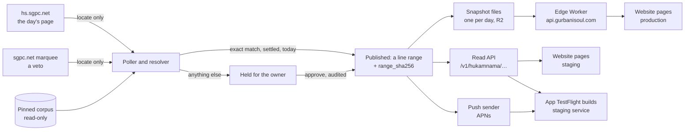

# The Hukamnama service

Every morning SGPC publishes the Hukamnama taken at Sri Harmandir Sahib, Amritsar. The Hukamnama
service (`services/hukamnama/`) finds that shabad **in the pinned corpus** and serves it as a range
of corpus lines. It is the server side of the feature the app and the website call
**"Hukamnama · Sri Harmandir Sahib"**.

It is a different thing from the app's **Hukam of the day**, which the device chooses by date from
its own corpus with no server at all. Copy, code and docs never call one by the other's name, and
nothing here is described as official: SGPC is credited as the source the service uses to locate
the day's shabad, and Gurbani Soul is not affiliated with SGPC.

This page is the shape of the whole thing. The day-to-day decisions are in
[the Hukamnama runbook](../process/runbooks/hukamnama.md); the Render service, its secrets and its
backups are in [the service runbook](../process/runbooks/hukamnama-service.md); the launch steps
and how to pull the public Hukamnama back are in [the launch runbook](../process/runbooks/hukamnama-launch.md);
the public API is [the Hukamnama API](../api/hukamnama.md).

## What runs today, and what is planned

The Hukamnama went public in **v1.7.0** (#418). The table says what the code does and, where it
depends on the deployment, what answered when it was checked on **2026-11-22**. The code on
`integration` is v1.7.4, and the website and scripture API were released as v1.7.4 that day; both
Hukamnama services still ran v1.7.3 code, so the v1.7.4 fix (the marquee's weekday cut by
position, #446) was released but not yet running in either service.

| Part | State (checked 2026-11-22) |
|---|---|
| The service: poller, resolver, decision store, read API, owner tools | **Running in production and on staging.** Production is the Render service `sggs-hukamnama-prod`, deployed from a release tag on `main` by `hukamnama-deploy-production.yml` (dispatch only); its `/health`, read through `api.gurbanisoul.com`, reported commit `be458bcd` (the v1.7.3 tag) and today published. Staging is `sggs-hukamnama-staging` at `api-staging.gurbanisoul.com`, deployed from `integration` by `hukamnama-deploy.yml`; its `/health` reported commit `bcf8f35e` (the v1.7.3 bump on `integration`). |
| State backup (Litestream to R2) | In the code and the image (#378); on when the four R2 values are set on the service. Whether each service has them is not visible from here. |
| Push to iPhones (APNs) | In the code (#381, #382). Staging: `push.sending: true` with two `asap` devices, and staging only ever reaches TestFlight builds; a push reached a TestFlight device end to end on 2026-11-11 (gurbani-soul-ios #130). Production: `push.sending: false` and no registered devices, so no phone is pushed from production. |
| The app's side: registration, sheet, card, widget, notification service extension | Shipped in TestFlight builds (gurbani-soul-ios #127, #128, #130). [What the app does](../ios/what-the-app-does.md#hukamnama--sri-harmandir-sahib-testflight-only) says App Store builds compile it out until its G3 copy review and G4 privacy changes are signed; whether a later App Store build includes it is **unconfirmed** here. |
| Public snapshot files | In the code (#383, #385). Production writes them to the R2 bucket `hukamnama-public` (created 2026-11-16). `wrangler.toml` names a staging bucket, `hukamnama-public-staging`; whether it exists and is written is unconfirmed. |
| Edge Worker (`services/hukamnama-edge`) for `api.gurbanisoul.com` | Deployed 2026-11-16 as `hukamnama-edge`, with `api.gurbanisoul.com` as its Custom Domain, reading `hukamnama-public`; the owner deploys it with `wrangler`, no workflow does. `/v1/hukamnama/today` and `/v1/status` answered 200 with today's day. `/health` and device registration reach the service through `ORIGIN_URL` with the shared `ORIGIN_SECRET`; reads are limited to 120 a minute per address. The production service refuses direct `/v1` calls (`HUKAMNAMA_ORIGIN_REQUIRED=on`: a direct read answered 403). |
| Website pages, feeds, sitemap and embed | In the code (#386–#391); **routed in production since v1.7.0** by `production.hukamnama_api` in `gateway/routes.json`. On gurbanisoul.com `/en/hukamnama`, the JSON feed, `/sitemap-hukamnama.xml` and `/embed/hukamnama` answered 200. Production pages read the public API (the Worker); staging pages read `api-staging.gurbanisoul.com`, the service itself ([the website](website.md)). |
| Developers page and the OpenAPI spec | Public since v1.7.0 (#393, #394, #418): listed, indexed and linked from the footer; the spec is `contract/hukamnama.openapi.json`, generated. |
| Website CDN purge | In the code (#432): after a published day is corrected, withdrawn or paused, the publisher deletes the `hukamnama` cache tag from Vercel's CDN, then once more 6 minutes later. On when `HUKAMNAMA_VERCEL_PURGE_TOKEN`, `HUKAMNAMA_VERCEL_PROJECT` and `HUKAMNAMA_VERCEL_TEAM` are set on the service; whether production has them is unconfirmed. |
| Watching from outside | `hukamnama-deadman.yml` reads **staging's** `/health` only (`HUKAMNAMA_STAGING_URL`): no workflow is a dead-man check for the production service. `hukamnama-morning.yml` compares every website surface with the API (below); its production job runs only when `HUKAMNAMA_PROD_SITE_URL` and `HUKAMNAMA_PROD_API_URL` are set, which is unconfirmed. |
| Planned, not built | The R2 copy of the fetch archive. |

## The flow

## The locate-only rule

SGPC's pages are used **only to find** the shabad. Every Gurmukhi character the service returns,
pushes or writes comes from `lines.gurmukhi` in the pinned corpus; none is copied from SGPC. Two
sources are read, with an honest User-Agent, `Cache-Control: no-cache` and ETags:

- **hs.sgpc.net**: the day's Hukamnama page. It must parse into one complete card whose own date
  stamp is today's Amritsar date.
- **The sgpc.net Mukhwak marquee**: a second opinion. If it already shows today and disagrees
  (Ang and opening words), the day is held. If it still shows yesterday, or cannot be reached, it
  is not waited for. The marquee ends with a date line; its weekday is cut before the comparison
  by position (one word ending the text after the last verse-ending danda and before the first
  comma), not from a list of spellings, so no verse word can be cut (`sources.py`, #446, after
  three weekday spellings held days in November). Its opening may start on the range's first
  verse or on any printed heading line before it, such as a Vaar's salok label (#430).

BaniDB is not used: its terms allow personal, non-commercial use only.

## The resolver and when a day publishes

`corpus.resolve` compares the page's verse words with the corpus under the locate key in
`hukamnama/locate.py`: Unicode NFC, zero-width characters dropped, SGPC's legacy-font form of the
subjoined ha read as the corpus writes it, dandas treated as separators, verse numbers dropped from
verse bodies. There is **no fuzzy tier**. A day publishes automatically only when all four hold
(`engine.py`):

1. hs.sgpc.net parses into a complete card dated today in Amritsar.
2. Its words equal, word for word, one run of consecutive corpus lines that starts on a verse (or
   on a printed salok or pauri label line, when the page prints the labels among the verses, as a
   Vaar unit on hs.sgpc.net does: #430; every word must still match), never bridges a gap in line
   ids, lies
   within one Ang of SGPC's Ang, and ends where a composition ends, or on a line that closes a
   numbered shabad (a marker with two or more numbers, such as ॥੨॥੩॥) inside a longer one, as
   where Bhagat bani keeps several shabads under one heading. When the first verse opens its
   composition, the served range starts at that composition's printed heading run in the corpus
   (up to 4 heading lines with the same `comp_id`, such as `ਸੋਰਠਿ ਮਹਲਾ ੪ ਘਰੁ ੧` and `ੴ`), never at
   SGPC's title. The source's title only decides one case: when the verse has no heading run of
   its own, the heading line just before it is included if its words equal the title.
3. The same resolution has been seen in an unbroken run of polls for at least 2 minutes, so a page
   saved half-way never publishes.
4. The marquee does not veto it.

Anything else waits, or is held. The same unmatched page seen 3 times over 5 minutes is held with a
`held_no_match` alert; when one corpus run with the page's word count differs in at most 3 words,
the alert names that run and the words. That is a diagnosis for the owner, never a decision. A
marquee disagreement is held with `held_veto`, and the alert names the Ang or the first opening
word that differs (#430). Two matching runs are not a match either: the day waits. **A late Hukamnama is acceptable; a wrong one is
not.**

`tests/test_corpus.py` writes every composition of the corpus the way SGPC writes it and resolves
it. Every composition and Vaar unit resolves to itself or is held; none resolves to another range
(the counts are in `services/hukamnama/README.md`).

After an automatic publish the service keeps reading both pages, about every 10 minutes, for 2
hours. A change raises
`changed_after_publish` or `veto_after_publish` and is **never applied automatically**.

## The two hashes

| Field | What it proves |
|---|---|
| `range_sha256` | sha256 of the range's `gurmukhi` lines joined by `\n` (UTF-8). The app, the website and the public snapshot each recompute it from their own copy of the corpus before showing a day; a mismatch shows nothing. |
| `scripture_sha256` | sha256 over every corpus line in id order (`id`, NUL, `gurmukhi`, newline). It equals the iOS database manifest's value, so equal values mean the same ids carry the same text. |

When the corpus fingerprint differs from the one recorded in its state file (a dataset bump), the
service proves every published day in the new corpus at start: the same line ids must exist and
hash to the `range_sha256` the day was published with. If all prove, they are re-pinned to the
new corpus and it carries on (audited as `repin`). If any does not, it refuses to serve, decide or
publish, and names the day; `correct` and `hold` still run, because they are the fix.

## The owner's tools

The owner's tools run on the service over `render ssh`, as `python -m hukamnama <command>`
(`__main__.py`); every one that changes something is written to the `audit` table with a name and
a reason.

| Command | What it does |
|---|---|
| `show <date>` | the stored decision and exactly what is served for that date |
| `approve <date> --first-line --last-line` | publishes that line range for the date, overwriting the decision; for a held or undecided day |
| `correct <date> --first-line --last-line` | replaces a **published** day's range, keeping its first publication time; the API and the snapshot add `corrected_at`, and the hash readers first saw is kept beside it. It refuses a day that is not published |
| `hold <date>` | withdraws a day, overwriting the decision |
| `resend <date>` | queues the day's push again for every device that already had it, and clears a tripped circuit breaker |
| `pause` / `resume` | stops serving and sending everywhere without a deploy: every day reads as `pending`, the snapshot drops every day file, nothing is pushed. The poller keeps deciding, so `resume` restores everything at once |
| `repin` | after a dataset bump, proves and re-pins the published days (below), or names those that do not prove |

An automatic publish never replaces an owner decision. Readers never see the word held: a held day
is served as `pending`, and a held day has no snapshot file. When each tool is used is in
[the runbook](../process/runbooks/hukamnama.md).

## Timing

Every date in the service is the **Amritsar date** (`clock.py`). IST is a fixed UTC+05:30 offset, so
no time-zone database is needed, and a naive datetime is refused.

| When (IST) | What |
|---|---|
| 05:00–09:00 | poll every minute |
| 05:30 | `expected_by`: SGPC stamps the Hukamnama 05:30 AM; a pending answer names this time |
| 07:00 | `late` alert if nothing has resolved; the dead-man check reads staging's `/health` (also at 06:00 and 14:15) |
| 07:15, 10:00 | `hukamnama-morning.yml` reads each page, the JSON feed and the embed from outside and holds the Gurmukhi each shows to the API's `range_sha256`; a mismatch opens one issue per Amritsar date |
| 09:00–14:00 | poll every 10 minutes |
| 14:00 | `not_published` alert if still nothing |
| 04:30–10:00 | deploy freeze for both services (23:00–04:30 UTC in `hukamnama-deploy.yml` and `hukamnama-deploy-production.yml`) |

## Alerts

Every new alert (one per day and kind) is stored, shown on `/health`, and, when
`HUKAMNAMA_ALERT_NTFY_URL` is set, posted at once to the owner's phone through ntfy (`alerts.py`):
holds and lost mornings urgent, late or changed pages high. Besides the poller's alerts, the
publisher raises `cdn_purge_failed` and the sender `push_breaker` (and the other push alerts) and
`device_flood`. The external dead-man check posts to the same topic when the staging service is
down; nothing outside watches the production service's `/health`. Setup: the [service runbook](../process/runbooks/hukamnama-service.md#phone-alerts-ntfy).

## Push

Sending is off unless `HUKAMNAMA_SEND=on`, which needs the APNs Auth Key; without a usable key the
service refuses to start. `push.py` builds every notification from the published decision, so its
text is the corpus's, and its shape is pinned to the app's fixture by a test. Beside the range,
a day records its ਰਹਾਉ couplet (`rahao_gurmukhi`, from `corpus.rahao_block`: the one line marked
rahao plus the verse lines before it back to a numbered verse end or a heading, at most 3), which
the read API and the push carry for the large widget; a shabad with no ਰਹਾਉ or several gets none. Only the **current
Amritsar day** is ever pushed, at most once per device per day: `asap` devices when the day
publishes, `scheduled` devices at their own UTC slot. Sends are durable rows that survive a restart;
a circuit breaker stops a day's run when more than 5% of its first results are 4xx, and deletes
nothing until a run finishes untripped. The device routes are `PUT` and `DELETE /v1/devices/<token>`;
nothing about a reader is stored beyond the token, its APNs environment, the mode, the UTC slot
schedule and the corpus fingerprint, and there is no access log. Which server a phone talks to is decided by the build: TestFlight
builds use staging, App Store builds production.

## The public snapshot and the edge Worker

So that a flood of public readers can never slow the poller or the push sender, `public.py` writes
each published day once as a file (`v1/hukamnama/<date>.json`, plus `index.json`), and optionally
to an R2 bucket. A day's file is written only when its lines, read again from the corpus, hash to
the `range_sha256` it was published with; an `approve` or a `correct` rewrites it, a `hold`
deletes it, and a `pause` removes every day file (the index then says `paused`) until `resume`.
After any of these the publisher clears the website's CDN copy (`purge.py`), when configured.
Production runs with the meaning layer off: its records carried no `translation` on 2026-11-22.
`HUKAMNAMA_MEANING=on` adds the English translation as a separate, labelled layer; the Gurmukhi is
identical either way.

The edge Worker serves those files as the public API and holds no scripture. It computes today's
Amritsar date per request, serves a file only when its own date equals the date asked for, never
serves a future date, and answers 503 rather than another day's text. Device registration and
`/health` are passed to the service: to `ORIGIN_URL`, the service's own https origin, when it is set
(required for a Custom Domain, which has nothing behind its hostname), otherwise to the same URL. The routes, caching and errors are on
[the Hukamnama API](../api/hukamnama.md) page.

## Hosting and environments

| | Staging | Production |
|---|---|---|
| Service | Render `sggs-hukamnama-staging` (Singapore, Starter, 1 GB disk at `/var/data`), `api-staging.gurbanisoul.com` | Render `sggs-hukamnama-prod` (Singapore, Starter, 1 GB disk), created 2026-11-16; its own origin answers `/health` only, every `/v1` read goes through the Worker at `api.gurbanisoul.com` |
| Deploys | `hukamnama-deploy.yml` on a push to `integration` touching the service, the dataset pin or the workflow, or by dispatch: tests on the exact commit, proves every published day in that commit's database (`hukamnama_preflight.py`), Render deploy hook with `ref=SHA`, then waits until `/health.commit` equals it | `hukamnama-deploy-production.yml`, **by dispatch only**, with a release tag that must be on `main`: tests on the tag, the same proof before the deploy (skipped only with `first_deploy`), Render deploy hook with `ref=SHA`, waits for `/health.commit`, and proves the published days again as served |
| Watched by | `hukamnama-deadman.yml` at 06:00, 07:00 and 14:15 IST (one issue per Amritsar date); `hukamnama-morning.yml` when its staging variables are set | `hukamnama-morning.yml` when `HUKAMNAMA_PROD_SITE_URL` and `HUKAMNAMA_PROD_API_URL` are set; no dead-man check |
| Reached by | TestFlight builds; the staging website's Hukamnama pages | the production website's Hukamnama pages and the public API, both through the edge Worker; App Store builds once the feature is on in them |

The service is not part of the website and API deployment of a release: `deploy-production.yml`
does not deploy it. After a release the owner dispatches `hukamnama-deploy-production` with the
new tag ([the service runbook](../process/runbooks/hukamnama-service.md#production-deploys-owner-by-hand)); that workflow is the
only way the production service changes.
