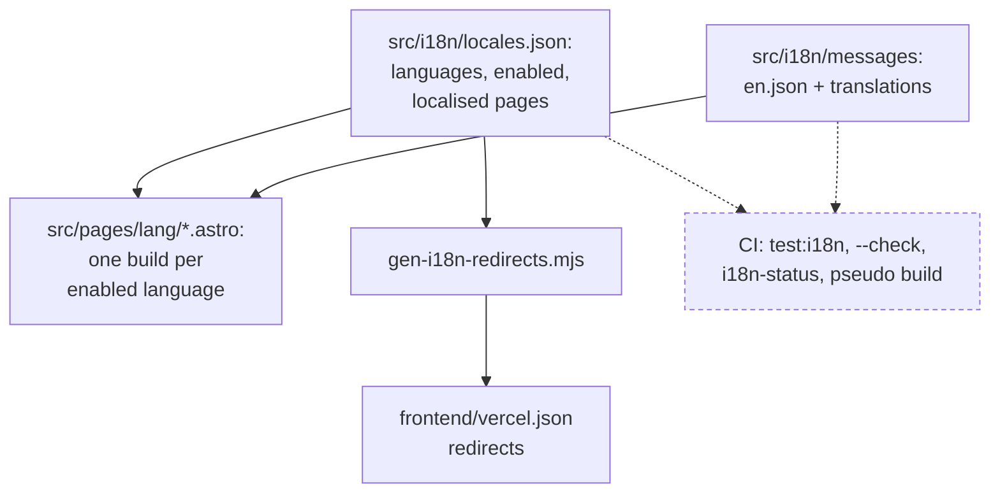

# Internationalisation of gurbanisoul.com

Since 1.6.0 the Gurbani Soul pages of `gurbanisoul.com` are built once per language, under a
language prefix: English at `/en` (the default and the source), Punjabi at `/pa` (switched on in
1.6.1) and French at `/fr` (1.6.2). Only the marketing site is translated: home, Features, The
watch, Learn, Support, Privacy and Contribute. The Knowledge Base, `/ang/N`, `/og/*`, `/rss.xml`,
`/sitemap.xml`, the app, Stripe checkout and the scripture are not, and keep their paths. This page
explains how the pieces fit; how a language is translated, reviewed and switched on is
[Translating gurbanisoul.com](../website/translation.md), with its
[style guide](../website/translation-style-guide.md) and [glossary](../website/translation-glossary.md).

## The configuration: `locales.json`

`frontend/src/i18n/locales.json` is the one place the languages are declared. It is read by the
typed wrapper `locales.ts`, by the redirect generator and by the unit tests.

| Field | What it holds |
|---|---|
| `default` | `en`. It must be defined and enabled. |
| `enabled` | The languages that build and ship. A language joins it only when its catalog is complete, current and signed off. |
| `locales` | Per language: `htmlLang` (the `<html lang>`), `intl` (the `Intl` locale for numbers and dates: `en-GB`, `pa-IN`, `fr-FR`), an optional `numbering` system, `ogLocale`, and `name`, the language's own name in its own script. |
| `localizedPages` | The pages that live under a prefix: `/`, `/features`, `/watch`, `/learn`, `/support`, `/privacy`, `/contribute`, `/hukamnama`. A page covers everything below it (`/learn/<slug>`, `/hukamnama/<date>`). `/hukamnama` is the one page with no static file per language: the server fills a built shell ([The website](website.md)). |

A broken file fails the build: `locales.ts` throws on any problem `configProblems` finds (an
unknown or duplicated language, a disabled default, a page with a trailing slash).

## Pages and URLs

Every marketing page is one file under `frontend/src/pages/[lang]/` whose `getStaticPaths` is
`localeStaticPaths`, so it builds once per enabled language. The URL rules are pure functions in
`src/i18n/core.js`, plain JavaScript so the Node scripts and tests can run them; `paths.ts` wraps
them for the pages:

- `localizeHref("/features", "fr")` gives `/fr/features`, and the home page is `/en`, not `/en/`.
  A Knowledge Base path such as `/search` is never prefixed; an external or `mailto:` link is left
  alone.
- `localeOf` and `stripLocale` read a path's language and remove it. Slugs are the same in every
  language, and there are no trailing slashes.

The bare `/` is `src/pages/index.astro`, a `noindex` language chooser. Each pre-1.6.0 URL
(`/features`, `/privacy`, …) keeps a small page, `LegacyRedirect.astro`, which forwards at once and
names the English page as canonical. On `gurbanisoul.com` neither is reached, because Vercel
answers first.

## The redirects generator

`frontend/scripts/gen-i18n-redirects.mjs` writes the `redirects` key of `frontend/vercel.json` from
`locales.json` (the rules are `redirects()` in `core.js`). It owns that key only; `tools/gen_gateway.py`
owns `rewrites`, so the two generators never overwrite each other. Run it with `npm run
i18n:redirects` after changing `locales.json`; CI runs it with `--check` and fails on a stale file.

| Request | Answer | Why |
|---|---|---|
| `/`, with an enabled language first in `Accept-Language` | **302** to that language | a per-visitor answer, never cached as permanent |
| `/`, otherwise | **302** to `/en` | crawlers send no language |
| a pre-1.6.0 marketing URL | **308** to the same page under `/en` | App Store Connect, the app and old links point at them |
| a known language that is not enabled | **302** to the same path under `/en` | switching it on later is not blocked by caches |

The release check `scripts/ops/verify_prod.py` proves on production that `/privacy` and `/support`
reach their `/en` page in exactly one permanent hop and `/` in one temporary hop.

## The language switcher and `gs_lang`

`LanguageSwitcher.astro` draws the choice in the nav, the phone menu and the footer, and nothing
while only one language is enabled. Each link opens the same page in the other language (a Learn
article that is not translated there opens that language's Learn index), with `lang` and
`hreflang`, and no flags: languages are not countries. The link is a full page load, so fonts,
`<html lang>` and the client strings all change.

The choice is remembered in the browser's local storage under **`gs_lang`**
(`src/scripts/landing.ts`), never a cookie. It is read in two places only: the root chooser, and a
language home page reached straight after the root's redirect, so a link or the back button is
never redirected. The privacy policy names it among the browser's stored settings
([security and privacy](security-and-privacy.md#privacy)).

## The message catalogs

Every interface string on a marketing page comes from `frontend/src/i18n/messages/en.json`, the
source, or its translation `messages/<lang>.json`, key for key. Messages are ICU (`{count}`,
`{x, select, …}`, `<link1>…</link1>`), rendered at build time with `intl-messageformat`
(`format-message.js`, typed by `t.ts`):

- `t(key, values)` gives plain text; `rich(key, values)` gives parts, and the page renders each tag
  part with its own element (`richMap`), so Astro escapes every translated word and a translation
  can never inject markup. A tag without a renderer, a missing key or a malformed message fails
  the build.
- `MessageKey` is the type of every dotted path in `en.json`, so a key that does not exist does not
  compile.
- French spacing is applied by the formatter: a narrow no-break space before `; : ! ?` and inside
  guillemets, so translators never type it.
- A client script that shows text reads its strings from a JSON block the page renders at build
  time (`ClientStrings.astro`, read by `src/scripts/i18n-client.ts`), and keeps its English
  fallback if the block is missing.

The scripture is never in a catalog. Gurbani on a page comes from the database, verbatim and cited
by Ang, and the `NoGurbaniInTranslations` gate checks every translated string against the corpus.
Learn articles are content, not messages; an article is published in a language only once it is
translated and reviewed (`src/i18n/content.ts`), and none is yet, so the Punjabi and French pages
link to the English articles.

## Numbers, money and dates

`src/i18n/format.ts` formats everything for the page's language, never the visitor's browser, so a
page builds the same everywhere:

- **Interface numerals follow the language.** Punjabi sets `numbering: "guru"`, which rides on the
  `Intl` tag (`pa-IN-u-nu-guru`): counts, dates, times, amounts and chapter numbers are written in
  Gurmukhi digits with Indian grouping. `useT().num` and ICU `{n, number}` use the same tag.
- **Ang numbers do not.** `fmtAng` writes an Ang in Western digits in every language, to match the
  printed index, the app and every link.
- **Money** is Australian dollars (`fmtAud`), with cents only when present.
- **Dates** are formatted in UTC. Pahar windows read as each language tells the time: the English
  wording of the dial, a 24-hour range in French, and spoken time of day in Punjabi.

## Search engines and sharing

Each marketing page names its language versions: one `hreflang` alternate per enabled language it is
built in, plus `x-default` pointing at the bare root (`alternates()` in `content.ts`). The sitemap
lists the same set, and the `SeoInvariants` gate checks that every set is self-referential and
reciprocal. Each language has its own `og:locale`, and the home page's structured data is built per
language, with the app's `inLanguage` left as `en`, because the app is English.

## Preview and pseudo-locale builds

Two builds exist only for checking, and are never deployed:

- `npm run build:preview` (`PUBLIC_I18N_PREVIEW=all`) builds every drafted language that has a
  catalog, enabled or not, falling back to English for a missing key, so a reviewer can read a draft
  on real pages.
- `npm run build:pseudo` (`PUBLIC_I18N_PSEUDO=1`) renders every message accented, bracketed and about
  40% longer (`pseudo.js`). Any plain English left on a covered page was typed into a component
  instead of the catalog, and the longer text shows where a layout would break.

## The checks

| Check | Where | What it proves |
|---|---|---|
| `npm run test:i18n` | `web-ci · frontend` | the config rules, the URL functions, the redirects, message rendering, French plurals and spacing, the pseudo-locale |
| `gen-i18n-redirects.mjs --check` | `web-ci · frontend` | `vercel.json`'s redirects equal a regeneration |
| `i18n-status.mjs` | `web-ci · frontend` | every enabled language has no missing, stale or extra key, tags equal to the English, valid ICU, and a review record whose sha256 matches its catalog; any broken catalog fails |
| pseudo build + `check_i18n_coverage.py` | `web-ci · frontend` | no interface English outside the catalogs |
| `build:preview` | `web-ci · frontend` | every drafted language still builds |
| `LanguageRouting`, `SeoInvariants`, `NoGurbaniInTranslations` | `web-ci · python` | the redirects and built languages match the config, every page declares its language and links within it, `hreflang` is reciprocal, no translation quotes the Granth |
| `e2e/i18n.spec.ts`, `e2e/marketing-nav-i18n.spec.ts` | `e2e` | root negotiation and old URLs in a browser; the navbar in every language from 320 to 1920 px |

What each workflow runs is on [CI gates](../process/ci-gates.md).
