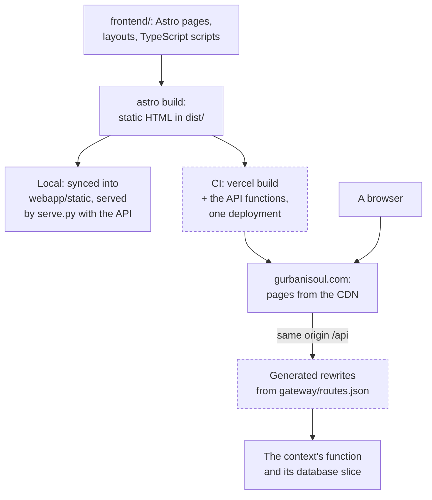

# The website

`gurbanisoul.com` is one static site, built with Astro from `frontend/`. Every page is plain HTML
built ahead of time; there is no server rendering, no client framework and no service worker.
Each page loads a few small TypeScript modules that call the read-only API on the same origin,
`/api/…`, so the browser never talks to another host for scripture. This page explains how
those pieces fit. The operational details (domains, SEO, images, the App Store switch) are in
[the website runbook](../website/README.md).

## Two sites in one build

The build holds two properties that are deliberately kept apart
([brand](../engineering/brand.md)):

| | Layout | Pages | Scripts it loads |
|---|---|---|---|
| **Gurbani Soul** (the app's home) | `Marketing.astro` | under each enabled language: `/en`, `/en/features`, `/en/watch`, `/en/learn/*`, `/en/contribute`, `/en/privacy`, `/en/support`, and the same under `/pa` and `/fr` | `landing.ts` only (it never imports the Knowledge Base code), Vercel Web Analytics on `gurbanisoul.com` |
| **Sri Guru Granth Sahib Ji Knowledge Base** | `Base.astro` | `/library` (its home), `/search`, `/reader`, `/nitnem`, `/browse`, `/themes`, `/lineage`, `/trail`, `/analytics`, `/constellation`, `/raag-clock`, `/divergence`, `/404` | `core`, `panel`, `studytrail`, `saroop` on every page, plus the page's own controller; no analytics |

The marketing pages are `frontend/src/pages/[lang]/*.astro`, built once per enabled language; the
bare `/` is a `noindex` language chooser, and the pre-1.6.0 URLs (`/privacy`, `/support`, …)
redirect permanently to their English pages. How the languages are wired is on
[internationalisation](i18n.md). The Knowledge Base is English only and is not prefixed.

`frontend/src/routes.ts` is the single list of public routes (a marketing page is listed once and
expands to one route per language); the sitemap is built from it, and a
repository gate fails if the sitemap and the built pages disagree. The share pages `/ang/N` (one
per Ang, `src/pages/ang/[n].astro`) are deliberately outside it: they carry Ang N's own Open Graph
card for link previews, send a person straight on to the Reader, and are `noindex`.

## The stack

- **Astro 7, static output** (`output: 'static'`, no adapter). Pages are `.astro` files in
  `frontend/src/pages/`; Learn articles are MDX in `src/content/learn/`.
- **No islands.** There are no UI-framework components and no `client:` directives. Interactivity
  is plain TypeScript in `frontend/src/scripts/`, one controller per page. The charts use D3 and
  Chart.js, loaded only on the pages that draw them.
- **Tailwind CSS 4**, CSS-first (`@import "tailwindcss"` in `global.css`, which lists the ordered partials in `styles/kb/`; `@theme` is in `kb/theme.css`, no config
  file). The marketing pages take their colours from the brand tokens (a gate checks `theme.ts` against
  them). The Knowledge Base has its own theme set, generated from `docs/brand/web-themes.json` by
  `scripts/brand/gen_web_themes.py`, which proves every text pair before it writes anything. A
  theme, the appearance, the paper tone, the text size and the saroop switch are chosen in the
  display sheet (`scripts/display.ts`), on every Knowledge Base page.
- **One overlay stack.** The composition panel, Saved and the display sheet register with
  `scripts/overlay.ts`: Escape closes the top one, Tab stays inside it, focus returns to the opener,
  and a page's own keys (the Reader's arrow paging) ask `overlayOpen()` first.
- **The Reader's controls** (`scripts/readerchrome.ts`): the Go-to sheet, the page bar, reading
  options and the swipe. It only navigates; `reader.ts` draws.
- **Jump anywhere** (`scripts/palette.ts`, imported on first use by `core.ts`): plain matching on
  `/api/meta` and `/api/banis`, never a second copy of the search fold.
- **Page transitions without a router.** The Knowledge Base opts into cross-document view
  transitions in CSS (`styles/kb/motion.css`, inside `prefers-reduced-motion: no-preference`): the
  bars are held, the page cross-fades. The marketing pages keep Astro's `<ClientRouter />`.
  Navigation links carry `data-astro-prefetch`.
- **Fonts are self-hosted.** Sant Lipi (SIL OFL) renders Gurmukhi and is limited by
  `unicode-range` to the Gurmukhi block, so it never downloads for an English-only page; the
  marketing pages add Source Serif 4. Both are preloaded.
- **Node 22** (`.nvmrc`), used for the build only.
- **Open Graph cards** are drawn at build time with HarfBuzz and resvg (`src/og/render.ts`, `src/pages/og/v2/`).

## How a page talks to the API

Every call goes through `api(path)` in `core.ts`, which fetches `/api/` + path on the same origin.
Because the API is same-origin, there is no CORS and no API host in the page; the rewrites in
`frontend/vercel.json`, generated from `gateway/routes.json`, send each prefix to its context's
function ([bounded contexts and the gateway](bounded-contexts-and-gateway.md)).

| Page | Calls |
|---|---|
| Every Knowledge Base page | `meta` (kept for the session), `random`, `shabad/{comp_id}`, `neighbors`, `lines`, `line_concepts` |
| `/search` | `search`, `verify` |
| `/reader` | `ang/{n}` (and prefetches the next and previous Ang), `neighbors`, `timing/clock` |
| `/nitnem` | `banis`, `bani/{key}` |
| `/lineage`, `/analytics` | `analytics/*`, `themes/network`, the build-time `contributors.json` |
| `/constellation` | `analytics/constellation`, `analytics/sky`, `analytics/pair`, `analytics/theme`, `timing/clock` (the This hour lens) |
| `/raag-clock`, `/divergence` | `timing/clock`, `timing/divergence` |

The Gurbani Soul pages make no API calls.

### The Hukamnama pages: filled by the server (staging only)

`/{lang}/hukamnama` and `/{lang}/hukamnama/YYYY-MM-DD` are the one exception to "every page is a
static file". The day's shabad has to be in the first bytes a crawler or a share card reads, and it
changes each morning, so `webapp/hukamnama_page.py` fills a page **shell** (built by the site, one
per language) with the day's record. Nothing is fetched in the browser.

It is off until two things exist: `HUKAMNAMA_API` (the public Hukamnama API's origin) and a shell
for the language under `webapp/hukamnama_shells/`. Without them those paths are answered by the
static site as before. The shell is `frontend/src/pages/[lang]/hukamnama/hk-shell.astro`; after
`astro build`, `frontend/scripts/extract-hukamnama-shells.mjs` checks it against the contract, moves
it out of `dist/` to `webapp/hukamnama_shells/<lang>.html` (git-ignored build output) and rewrites
its own path to `/{lang}/hukamnama__HK_SUFFIX__`, so the canonical, hreflang and language switcher
are right for today's page and for a dated one. `tools/build_api_functions.py --verify-output`
refuses a deploy whose static output still holds a shell.

On Vercel the pages are answered by the `all` API function, per environment:

- **Routing.** An environment that names `hukamnama_api` in `gateway/routes.json` gets two
  generated rewrites, `/(en|pa|fr)/hukamnama` and the dated form, to `/api/svc/all`. Staging names
  it (`https://api-staging.gurbanisoul.com`). Production does not yet, so on gurbanisoul.com the
  paths are still a 404 until launch; turning them on is that one line plus `gen_gateway.py`.
- **Which API.** The generated `all` entry sets `HUKAMNAMA_API` from that file, chosen by Vercel's
  `VERCEL_ENV` (staging is a preview deployment), so a production deployment can never read
  staging's API. A `HUKAMNAMA_API` set on the Vercel project wins; an empty value there turns the
  pages off without a deploy.
- **The shells.** They exist only after the site build that runs inside `vercel build`, so the
  deploy adds them afterwards: `build_api_functions.py --add-shells` copies each language's shell
  next to the API code and names it in the `all` function's file map. `--verify-output` then
  refuses the deploy unless `all` holds a whole shell for every enabled language, every `/_astro`
  file a shell names is in the static output, and no other function holds one.
- **After the deploy.** `scripts/ci/verify_functions.py` requests `/{lang}/hukamnama` for every
  language: a filled page from `all` in that language with no template token left. A 503 from the
  function is a warning, not a failed deploy (the Hukamnama API was unreachable).

A date in the future or an unknown path under these routes is a plain-text 404 from the function,
not the site's styled 404 page (the function does not bundle the static site).

### The Hukamnama feeds

`/feeds/hukamnama.xml` (Atom) and `/feeds/hukamnama.json` (JSON Feed 1.1) list the most recent
published days, newest first, up to 30. `webapp/hukamnama_feed.py` builds them in the same `all`
function, under the same switch and routing as the pages (`hukamnama_api`; staging only so far),
and each page's `<head>` links both. The paths sit outside the language tree on purpose: a feed is
one document, and `/feeds/…` is not caught by the generated language redirects.

The rules are the pages' rules:

- From the API's list only each day's date, line-id range, `range_sha256` and publication time are
  used. The text comes from the server's own corpus, and a day enters a feed only after its lines
  hash to `range_sha256`. A day that does not prove is left out and logged; it is never shown.
- A day dated after the Amritsar date at that moment is left out, whatever the API lists.
- Titles and summaries carry the name, the date and the Ang, never scripture. In an entry's
  content the Gurmukhi comes first in its own block (`lang="pa"`); transliteration and, when the
  meaning layer is on upstream, the English translation follow, each under its own label.
- Feed labels are English; the entries link to the English page. Per-language feeds are not built.
- A feed is cached for two minutes. If the API is unreachable the last proven list is served;
  with nothing proven yet the answer is 503 with `Retry-After`.
- After a deploy `verify_functions.py` requires both to be whole feed documents from `all`.

### The Hukamnama sitemap, the day-to-day links and structured data

The site's `/sitemap.xml` is static and lists the static pages. The Hukamnama pages gain a URL per
language every morning, so they have their own, `/sitemap-hukamnama.xml`, built by
`webapp/hukamnama_sitemap.py` in the same `all` function under the same switch and routing.

- It lists, for every language that has a shell, the today page and one URL per published date,
  newest first, each with its other-language versions (the same set the page's `<head>` carries).
  `lastmod` is when that day was published. It holds URLs and times only, no scripture.
- The dates come from the API's `GET /v1/hukamnama/index` (every published day, no text); an API
  without that route is asked for its latest 30 instead. A date after the Amritsar date at that
  moment is never listed, whatever the API says.
- `robots.txt` does not name this sitemap yet: it is added at launch, when production serves it.
- The same list gives each page its **previous and next published day**, as links labelled with
  those days' dates (no new words to translate). Unpublished days are skipped. If the list cannot
  be read the page is shown without the links.
- Each page's JSON-LD is a `WebPage` and, since the shell carries the section's name, a
  `BreadcrumbList`: the site, the Hukamnama page and, on a dated page, that date.
- After a deploy `verify_functions.py` requires a whole sitemap from `all` that lists each
  language's page.

### The Hukamnama embed

`/embed/hukamnama?lang=en&theme=auto` is a small page for another site to show in an `<iframe>`
(a Gurdwara's website, a blog). `webapp/hukamnama_embed.py` builds it in the same `all` function,
under the same switch and routing as the pages.

- **What it shows.** The section's name (a link to the Hukamnama page), the Hukamnama's own date,
  every Gurmukhi line, the citation (a link to that day's page) and the credit. The day is chosen
  by the page's rules: today's once published, otherwise the most recent under its own date with
  the same status line. The lines come from the server's corpus and are shown only after they
  hash to the published `range_sha256`; otherwise it says it cannot be shown, with no text.
- **What it is.** One HTML document, about 3 KB, with its styles inline and the site's Gurmukhi
  font. No script, form, button or image, and no request to any other host. Links open in a new
  tab and stay on this site. It is `noindex` (meta and `X-Robots-Tag`).
- **Parameters.** `lang` (a language whose shell carries the embed's words; default `en`) and
  `theme` (`auto`, `light`, `dark`; default `auto`, which follows the visitor's system). Any other
  value means the default. Nothing from the query string is written into the document.
- **Words.** All from existing reviewed strings, carried in the shell's string block (`name`,
  `credit`, `unavailable`); the embed adds none.
- **Framing.** It is the one path that may be framed
  ([security and privacy](security-and-privacy.md)). A host page must be served over http(s):
  `frame-ancestors *` does not cover a local `file://` page.
- After a deploy `verify_functions.py` requires the embed to be framable under its own policy and
  the rest of the site not to be.

### The Developers page

`/{lang}/developers` (`frontend/src/pages/[lang]/developers.astro`) explains the public Hukamnama
API to the people who will call it: a first request, the routes, the record's fields, how to check
the text against `range_sha256`, how to show and credit it, the embed snippet, the feeds, limits
and the terms. It is an ordinary static, translated page in the legal-page frame, with no script
of its own.

- **It states what the code does.** The archive's first date, the list bounds and the embed's
  themes are constants in `frontend/src/hukamnama.ts`, and the `DevelopersPage` gate compares them
  with `services/hukamnama-edge/src/core.js` and `webapp/hukamnama_embed.py`. The API's
  `terms_url` (`public.py`) points at `#terms` on this page; the gate holds the two together.
- **The example record is a real day's, without the text.** Its ids and `range_sha256` are the
  record for 2026-11-11, and the gate re-computes that hash from the corpus. Every text field in
  it is `"…"`: no line of Gurbani is typed into the page or shown in a code font.
- **One switch for launch.** `HUKAMNAMA_LIVE` in `hukamnama.ts` is true when
  `gateway/routes.json` gives `production` a `hukamnama_api`, the same key that turns on the
  pages, feeds, sitemap and embed there. Until then the page is built but `noindex`, absent from
  `sitemap.xml` and linked from nowhere; from then it is indexed, listed and linked from the
  footer. It is read from the file, never from the build's environment, so the committed
  `webapp/static`, staging and production are the same build. The documented API origin is that
  key's value, or `https://api.gurbanisoul.com` before it is set.
- Messages with code in them use `<c>…</c>`, rendered by `CodeText.astro`; literal values with a
  colon (`UTC+05:30`) are passed as values so French spacing never touches them.

What the renderer guarantees:

- It asks the API for one **date** (the Amritsar date it computes itself), never "today", and
  refuses an answer that names another date.
- From the API it uses only the line-id range and `range_sha256`. Every Gurmukhi line, its
  transliteration and (when the meaning layer is on upstream) its English come from the server's
  own corpus, and the page is rendered only after those lines hash to `range_sha256`. Otherwise it
  answers 503 with no text.
- Nothing is called "today" unless its date is the Amritsar date at that moment. Before the
  morning's publication the page shows the most recent Hukamnama under that Hukamnama's own date.
- Every value is HTML-escaped; the JSON-LD cannot close its `<script>`.
- Today's page is never cached past Amritsar midnight; a dated page is cached for a day; a page
  with no Hukamnama is `noindex`.
- If the API is unreachable, a day already proven on this server is still served; anything else
  is 503 with `Retry-After`, and the API is not asked again for 10 seconds.

The shell contract (tokens, conditional blocks, the language's words) is documented at the top of
`webapp/hukamnama_page.py`; `webapp/tests/fixtures/hukamnama-shell.html` is a minimal shell.

## Rules the scripts keep

- **Everything from the API is escaped.** Scripture and API text reach `innerHTML` only through
  `esc()` in `core.ts`. This is one of the [engineering invariants](../engineering/invariants.md).
- **Saroop is display-only.** `saroop.ts` draws the traditional subjoined-ya form in the rendered
  glyphs only; the stored text, search, the API and Copy stay verbatim (a copy handler strips the
  display markup). It is on by default and remembers an explicit choice.
- **The pinned verse is read from the API model.** The Study Trail pins verbatim text from the
  API (`data-gm`), never from the rendered glyphs, which saroop may have changed.
- **State stays in the browser.** Preferences (theme, colour theme, paper tone, transliteration, text size, saroop, raag
  clock mode), reading positions and pinned verses (at most 500) live in `localStorage`, as does
  the marketing site's language choice (`gs_lang`, written by the language switcher in
  `landing.ts`); the
  `meta` and timing responses and the Semantic Trail path live in `sessionStorage`. There are no
  cookies and no accounts; the [privacy policy](../../frontend/src/pages/[lang]/privacy.astro) describes
  the same set.

## Build, test and deploy

| Step | Where | What |
|---|---|---|
| Build | `npm run build` | `astro build` into `frontend/dist/` |
| Local serving | `npm run sync` | copies `dist/` into `webapp/static/` for `serve.py` (a backup goes to `static.bak/`) |
| Checks | `web-ci` (`frontend` job) | build, `astro check` (advisory), the pahar vectors, the language rules and redirects, the translation status, the pseudo-locale coverage check and the preview build ([CI gates](../process/ci-gates.md)) |
| Repository gates | `web-ci` (`python` job) | SEO, sitemap, RSS, the external-request allowlist, no secrets in the source, theme tokens, page-weight budgets for the Gurbani Soul pages |
| Browser tests | `e2e` (`playwright` job) | the Playwright specs in `frontend/e2e/` against `serve.py`: the CSP with zero violations on every route, axe on the main pages, the reader and search smoke |
| Staging | `deploy-staging.yml` | build the API functions, `vercel build`, deploy, alias `sggs-staging.vercel.app`, purge the CDN, then `@smoke`, the gateway probes and the golden contract |
| Production | `deploy-production.yml` | the same build deployed unaliased, verified, promoted to `gurbanisoul.com`, then `@smoke` on the public domain; a failure rolls back automatically ([deploy runbook](../process/runbooks/deploy.md)) |

The Vercel project's own Git deployments are off; only these workflows deploy. The security
headers the site sends are on [security and privacy](security-and-privacy.md).
