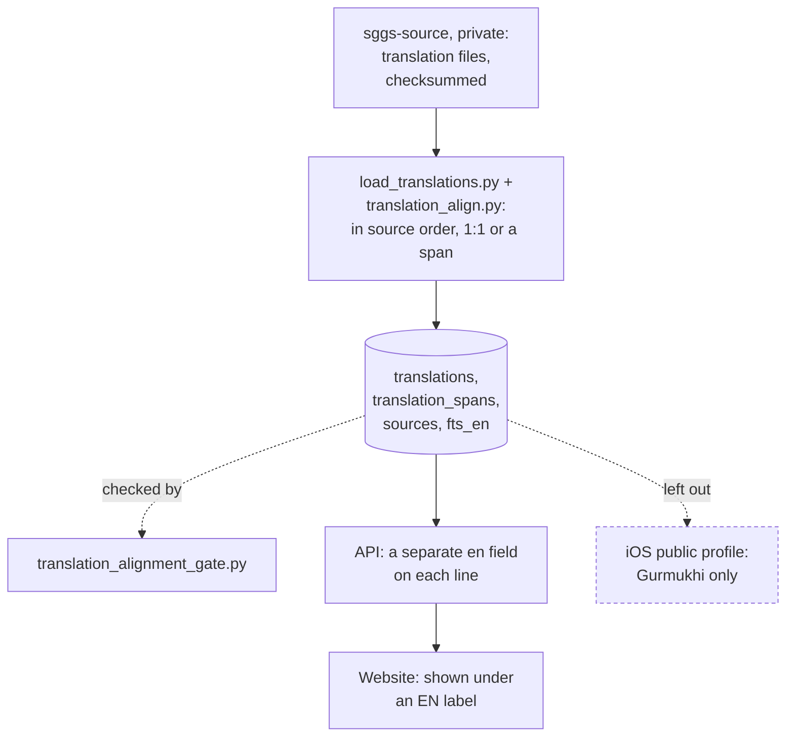

# The English translation layer

Beside the Gurmukhi, the database carries an English translation by **Dr. Sant Singh Khalsa**.
It is a separate layer: its own table, its own index, its own field in the API, and a visible
"EN ·" label on the site. It never replaces, edits or mixes with the Gurmukhi, and a translation
is never presented as the original ([invariants](../engineering/invariants.md)). In dataset 1.4.0,
60,584 of the 60,658 lines (99.9%) have English: 60,506 translation rows, 73 of which cover a group
of two to four printed lines.

## Where it comes from

Two sources are registered in the `sources` table, both the same translator:

| `source` | Rows | Attribution (as stored) | Terms (as stored) |
|---|--:|---|---|
| `ssk-shabados` | 59,835 | via the ShabadOS open database, release 4.8.7 | open data with attribution; the translation author must be credited |
| `ssk-banidb` | 671 | via BaniDB | personal, local, non-commercial use with attribution |

The input files are not in any public repository. sggs-data's `scripts/data/fetch_translations.sh`
downloads them from a private release (`translations-en-v1` in `sggs-source`) and checks every
file against the committed `pipeline/translations.SHA256SUMS`; `rebuild_all.sh` refuses to start
if any file is missing or altered. The ShabadOS file is loaded first; the older BaniDB files
(Angs 1–13 and 917–922) are loaded second and may replace a single-line ShabadOS row for those
lines, but never a span or any line inside one.

## How a translation finds its line

The source files pair a Gurmukhi text with its English, in the Granth's order. Since dataset 1.4.0
(sggs-data #20) `load_translations.py` no longer matches each record on its own, "first candidate
wins": it hands both streams to `pipeline/translation_align.py`, which aligns them **once, in
order**. That fixed two losses of the old loader: a record that joins several printed lines equals
no single line and was dropped, and a repeated line (a refrain, a heading) always took the first
occurrence's English, so the repeat's own record was thrown away.

The alignment, as the module describes it:

1. **Anchors.** Records whose normalised text (NFC; punctuation, digits and the trailing rahao
   label removed) occurs exactly once in the source and once in the corpus, at an Ang within one,
   kept only where they are mutually in order.
2. **The gaps.** Between consecutive anchors a small dynamic programme aligns the rest with five
   steps: skip a record, skip a line, a 1:1 match, or a 1:k span.
3. **Ties are not guessed.** The programme runs twice, preferring the earliest and then the latest
   of equal-cost paths; a placement the two runs disagree on is not made. No English is better than
   English under the wrong line.

| `match_quality` | Rule | Rows |
|---|---|--:|
| `exact` | the normalised text is identical | 58,602 |
| `skeleton` | the consonant skeleton (vowel signs removed) matches | 528 |
| `fuzzy` | similarity of at least 0.92 | 1,303 |
| `span` | the record equals two to four consecutive lines of one composition joined, none of them a heading | 73 |

A 1:1 match wins over a span at equal cost. A span's English is stored once, on its **last** line,
and the group is recorded in `translation_spans` (`first_line_id`, `last_line_id`): 69 spans of two
lines, three of three and one of four. The Gurmukhi is only read here, never written: the corpus is
compared, not changed.

**The gate.** `pipeline/translation_alignment_gate.py`, written independently of the loader, runs
in sggs-data's `data-ci.yml` and in `make ci`. It always checks the structure: every span covers two
to four consecutive lines of one composition with no heading, spans never overlap, the English sits
on the last line with quality `span`, no other member has its own English, and no English string is
empty. When the private source files are present (a local rebuild) it also checks that every
English string is byte-identical to a source record matching its line, that the placed records are
in source order, and that no record is used twice. The rebuild's audit, every changed row and the
two reviewed exceptions are in sggs-data's `validation/translation-alignment-*.json`.

**Coverage.** 74 lines have no English: 33 headings and 41 verse lines, spread over 43 Angs (Angs
214 and 1361 have the most, four each). Before 1.4.0 it was 2,287 headings and 332 verse lines.
Those lines are returned without an `en` field.

## In the API and on the site

- **API.** Lines that have a translation carry it as `en`: in search results (every mode), in
  `/api/ang`, `/api/shabad`, `/api/bani` (Granth lines only; lines from outside the Granth never
  get English) and `/api/neighbors`. There is no per-line source field; `/api/meta` and
  `/api/health` report the number of rows as `translations_en`. `attach_translations` in
  `webapp/sggs/core.py` adds the field from the `translations` table and does nothing if the
  table is absent. Every line of a span also carries `en_span` (`{first, last}` line ids), and the
  English goes on the last member present in that response, so a list shows it once under the
  group even when an Ang boundary cuts the span ([the line record](line-record.md)).
- **Website.** Every surface renders the English in its own escaped element with `lang="en"`,
  labelled "EN ·" by the stylesheet, below the Gurmukhi. The Reader, the composition panel and
  Nitnem join a span's lines with a quiet margin rule and show its English once, under the group. The footer credits the translator
  whenever `translations_en` is above zero. Learn articles show Gurmukhi only, by design.
- **iOS.** The App Store build uses the `public` profile, which leaves out `translations` and
  `fts_en`; the app then hides its English toggle, English search and credit line. A build with
  English (`personal` profile, which keeps `translation_spans`; the public profile drops it) is refused by `check_release_license.sh` unless the licence file
  says `LICENSED: true` ([the iOS database pair](../ios/db-pair-and-launch-integrity.md)).

## Searching the English

`fts_en` is an FTS5 index over `translations.text` with the default `unicode61` tokenizer:
case-insensitive, no stemming, stop words indexed.

- **`mode=english`** searches only this index. Each word is quoted and the words are joined with
  AND, so every word must appear; there is no prefix matching (`*` is stripped), no phrase
  search and no stemming ("forgive" and "forgiveness" are different words). Results are ranked by
  plain BM25.
- **`mode=auto`** reaches English only when the query is in Latin script and the earlier tiers
  (theme names, transliteration, the seeker lexicon, variants) found nothing. It comes before the
  Roman fold on purpose, so an English word reaches the translation instead of colliding with a
  folded Gurmukhi word ([modes and tiers](../search/modes-and-tiers.md)). Some English words
  never get here because the seeker lexicon maps them first (for example "mercy" and "love").
- The response names the tier in `mode` (`english` or `english-translation`). One quirk: when
  every tier finds nothing, `mode` can still read `english-translation` with zero results. Treat
  `mode` as a hint, as the modes page says.

The golden contract pins English behaviour: eight `mode=english` queries (including empty and
punctuation-only input) and three auto queries that resolve to the translation.

## Licence status

This section records what the repositories say; it is not legal advice, and the decision rests
with the owner.

- The `sources` table stores the terms above. The platform's `NOTICE.md` restricts the English to
  personal, local, non-commercial study and says a written licence from the rights holder is the
  only route to public or commercial distribution.
- The iOS App Store build therefore ships without English, enforced by the licence gate, and the
  support page tells users why.
- The public website and API serve the English today. That is an open item in the
  [risk register](../risk-register.md) ("English translation is not licensed for distribution").

## Known issues

- **The footer credit names BaniDB** ("via BaniDB", `scripts/core.ts`), while 59,835 of the 60,506
  rows come via ShabadOS; the README names ShabadOS correctly.
- **Checksummed but never loaded.** sggs-data's checksum list includes files for Angs 262–296 and
  an `en_repair` file that no load step picks up (the load globs match only the other files).
- **No per-line provenance in the API.** A client cannot tell which source a given `en` came from.
