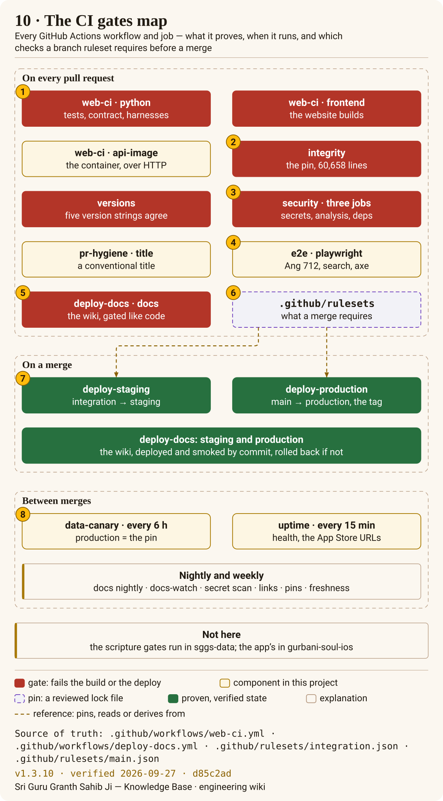

# CI Gates — what each check proves

**Required checks** (`.github/rulesets/*.json`, applied by `scripts/gh/apply_rulesets.sh`): to
merge into `integration`, `python`, `frontend`, `integrity`, `secrets` and `docs`; into `main`,
those five plus `versions` and `static-analysis` (strict: the branch must be up to date). Every
other check below is a signal — a red run does not block a merge — unless a deploy waits for it
(`playwright`, below).

| Workflow · job | Proves | Needs |
|---|---|---|
| `web-ci · python` (**required on `integration` and `main`**) | ruff clean; server + repo-gate unit tests; the **contributors roster** (`frontend/public/contributors.json`) proven against the pinned corpus — names, pen-names, Banis and cited sources (`tools/check_contributors.py`); the **golden contract replayed over HTTP** (`tools/contract_http.py`); `contract/openapi.json` is current and covers every dispatcher route; the public Hukamnama API's spec, `contract/hukamnama.openapi.json`, is a fresh run of its generator against the service's snapshot writer and the edge Worker's handler (so this job installs Node and the check may not skip), still requires every key the shipped iOS app decodes, keeps the English layer optional, holds no Gurmukhi and matches the fields the Developers page describes (`services/hukamnama/tests/test_openapi.py`); the Hukamnama service's own unit tests (the whole-Granth resolver property, the push sender; the push and Node-dependent tests may not skip); `/api/health` all-true; the **shabad-heading regression** (`api_superset_check`); the casual-quote search harness (gating) and the round-trip harness (report-only); **contract does not drift**; `ruff format` is a warning only | pinned DB, Node |
| `web-ci · frontend` (**required on `integration` and `main`**) | the Hukamnama edge Worker's unit tests first (`services/hukamnama-edge`): the Amritsar date boundary, a file that names another day is never served, pending before publication, date and limit validation, ETag, CORS only on reads, the origin secret on passed-through requests; then Astro builds (`npm run build`, which also checks every share card); `pahar` vectors pass (`npm run test:pahar`); the **language rules** pass (`npm run test:i18n`: `locales.json` is valid, URLs localise and strip as specified, the generated redirects, every message parses and renders, values are never markup, French plurals and spacing, the pseudo-locale); the redirects in `frontend/vercel.json` equal a regeneration from `locales.json` (`node scripts/gen-i18n-redirects.mjs --check`); **every enabled language is complete, current and reviewed** (`node scripts/i18n-status.mjs`: no missing, stale or extra key, tags equal to the English, every message valid ICU, and a review record whose sha256 matches the catalog; a broken catalog of a draft language fails too); **no interface English outside the message files** (`npm run build:pseudo`, then `scripts/ci/check_i18n_coverage.py dist-pseudo` finds any visible text or accessible name on a covered page that did not come from the catalog, Gurmukhi, transliteration and formatted values exempt); **every drafted language still builds** (`npm run build:preview`, `PUBLIC_I18N_PREVIEW=all`, never deployed); **report-only:** `astro check`, and that the committed `webapp/static` equals the build's text assets byte for byte (`scripts/ci/check_static_fresh.py` — a warning, not yet a gate) | Node 22 |
| `scripture-integrity · integrity` (**required on `integration` and `main`**) | dataset pin: `dataset.lock.json` ↔ `contract/_meta.json`, and sggs-data publishes that object at the pinned commit; the installed DB passes `quick_check` with 60,658 lines over Angs 1–1430 (the scripture gates themselves run in sggs-data) | pinned DB |
| `version-consistency · versions` (**required on `main`**) | the one version is identical in `webapp/serve.py`, `frontend/package.json`, the README badge, the `MASTER-INDEX.md` header and the top `CHANGELOG.md` entry (`scripts/release/check_versions.py`; the dataset versions in sggs-data, the iOS app keeps its own match); `main` PRs come from `integration`/`hotfix` | — |
| `security · secrets` (**required on `integration` and `main`**; every pull request, pushes to `integration`/`main`, Mondays 06:00 UTC) | gitleaks 8.21.2 (pinned release, checked against its SHA-256, `.gitleaks.toml`): on a pull request or a push, the working tree (`--no-git`); on the Monday schedule, **the whole git history** of the default branch (a full clone; it fails if the clone is shallow), where the only findings let through are fingerprints listed in `.gitleaksignore`, each with the reason it is not a secret | — |
| `security · deps` (**required on `integration` and `main`**) | `npm audit --audit-level=high` on `frontend/` and `docs-site/` (`scripts/ci/npm_audit_gate.py`; dated exceptions only, see below); `deploy-production` waits for it | — |
| `security · static-analysis` (required on `main`) | actionlint over the workflow files gates the job; bandit and semgrep OSS report only | — |
| `pr-hygiene · title` | conventional-commit PR title | — |
| `e2e · playwright` | Ang 712 heading smoke, search → panel heading, axe WCAG (serious and critical) on `/`, `/search`, `/features`, `/watch` and `/learn`; the Knowledge Base shell on every KB route and the 404 page (`frontend/e2e/kb-shell.spec.ts`): unique ids, a viewport that still pinch-zooms, and axe in the light and the dark theme against a per-page list of known violations that can only shrink; sideways scroll on a 375 px phone is measured and **reported as a warning** — the Knowledge Base sets its Latin text in the system font, so that baseline is per platform, enforced on macOS today and on the Linux runners once a Linux baseline is recorded in the spec. One job, two steps: the desktop project (Chromium), then the phone project (iPhone 13, WebKit). Not a required check, but both `deploy-staging` and `deploy-production` wait for it | serve.py + pinned DB, Node, Chromium, WebKit |
| `e2e · kb-lighthouse` (report-only, never blocks) | Lighthouse with mobile emulation on `/search`, `/reader?ang=1` and `/nitnem`, served by `serve.py`; three runs each, no assertions (`frontend/.lighthouserc.json`); the reports are the `kb-lighthouse` artifact | serve.py + pinned DB, Chrome |
| `web-ci · api-image` | Docker image builds; the running container reports the build commit **and honours the golden contract over HTTP**; a one-service image from the same Dockerfile (`SGGS_MODULES=knowledge`) is ready with exactly its context, answers its own route, 404s another service's, and carries a database slice under 5 MB | Docker |
| `web-ci · hukamnama-image` | the Hukamnama service image builds as Render builds it; Litestream is the pinned version and `litestream.yml` parses; R2 credentials without the endpoint and bucket make it refuse to start; without credentials it starts plainly and reports the build commit on `/health`; the push dependencies are installed; `HUKAMNAMA_SEND=on` without an APNs key refuses to start | Docker |
| `deploy-verify` (on Vercel `deployment_status`, previews only) | preview `/api/health` all-true (passes with a notice without the repo-level bypass secret) | — |
| `release` (manual fallback) | idempotent tag + GitHub Release on `main`; normal releases are cut by `deploy-production` after a verified deploy | — |
| `data-canary` (every 6 h, not a PR check) | production serves the pinned scripture byte for byte: 500 random lines (`/api/lines`) and 12 random Angs plus Angs 1, 712, 1430 (`/api/ang/N`), from the API origin **and** through the public site's CDN; the golden contract replays against production; a failure opens or updates one issue | pinned DB |
| `deploy-staging · gates` / `preflight` | the push to `integration` waits for `python`, `frontend`, `integrity` and `playwright` on the exact commit, and the staging Vercel secrets exist | — |
| `deploy-staging · deploy-web` | the API functions are generated at the commit from the pinned database (slices proven); after `vercel build` every function bundles only its entry, the API code and its own database, `all` also holds a whole Hukamnama page shell for every language (added by `--add-shells`; every `/_astro` file a shell names exists), and no database, API source or shell is in the static output | pinned DB |
| `deploy-staging · verify` | every API function's `/readyz` reports this commit and exactly its contexts; no API file is downloadable; where the environment serves the Hukamnama pages, `/{lang}/hukamnama` is a filled page from `all` in each language both Hukamnama feeds and the Hukamnama sitemap are whole documents from `all`, and the Hukamnama embed is the one framable response while `/` and the pages still forbid framing (a 503 from the function is a warning); the web smoke; every routed context answers **through the gateway** with its own `X-Service`; an unknown prefix falls through to `all`; the **whole golden contract passes through the gateway** | bypass secret, pinned DB |
| `deploy-docs · docs` (**required on `integration` and `main`**) | the wiki (`docs-site/` over `docs/`, ADR-0012): pinned sibling docs consistent and installed; `tools/docs_check.py` (frontmatter, links and anchors, widget fallbacks, Mermaid palette, the scripture-quotation rule, posters, the `verified` stamps on process/engineering/architecture pages and every `covers:` entry, every code area of `tools/docs_areas.json` — each service, server module, website page and workflow — on some page or listed as exempt or backlog, drift against the code: search modes, verify thresholds, generated pages; the poster legend; the site theme's brand colours equal `docs/brand/tokens.json`; the CSP allows inline scripts by hash only); every generated page equals a regeneration (`tools/gen_route_table.py`, `gen_data_dictionary.py`, `gen_api_errors.py`, `gen_contributors.py`, `gen_env_vars.py` `--check`, `gen_facts.py`, `gen_repo_map.py --check`); every committed poster equals its spec (`build-posters.mjs --check`); `scripts/brand/contrast_report.py --check` (the committed contrast report equals a regeneration from `docs/brand/tokens.json`, frontmatter included); tool and plugin unit tests; types (`astro check`); the site builds with **every Mermaid fence rendered to SVG** and every page exported as Markdown and as a PDF; every page rendered completely; every internal link and fragment in the built HTML resolves; page budgets (JS ≤ 60 KB gz); every inline script allowed by its sha256 in the CSP, no inline handlers (`scripts/csp.mjs`); Playwright e2e (mocked API) + axe on every built page, **served with the production headers and CSP** (a blocked script fails the check); on a pull request, the visual baseline of the reading layout, compared in the pinned Playwright container (a difference fails the check); Lighthouse (performance ≥ 0.9, accessibility 1, best-practices ≥ 0.95) on five representative pages for a pull request or a push to `integration`, and on all twenty nightly and on `main`; every page's Open Graph card exists; the docs-health numbers (`tools/docs_check.py --health`) are measured before the build for [Docs health](../reference/docs-health.md), and again before the `deploy-staging` and `deploy-production` builds; the health step reads each merged pull request's description with the workflow token (`pull-requests: read`) to measure the coupling debt on `integration`; browsers and fonts come from `scripts/ci/install_browsers.sh` (network retried) | Node 22, Chromium, pinned DB, sibling read token |
| `docs-coupling` (every pull request, also when its description is edited; **enforced** for `covers:` pages, not a required check) | the wiki pages whose covered code the pull request changes (their `covers:`, or the files they cite) while neither the page nor its `verified` stamp changes (`tools/docs_coupling.py`). A page is excused only by its own description line `Docs-impact: docs/<page>.md — <reason>`; a blanket `Docs-impact: none — <reason>` excuses only cited-files pages. With `COUPLING_ENFORCE: "1"` an unexcused `covers:` page fails the job; a release pull request (`integration` → `main`) and a `bot/…` branch are reported with the reason and never fail. Written to the job summary and one sticky comment that prints the lines to add (`pull-requests: write` on this job only); red does not block a merge until the owner makes it required ([the runbook](runbooks/docs-site.md#the-docs-impact-check)) | — |
| `deploy-docs · deploy-staging` / `deploy-production` | the wiki is deployed only by CI: `integration` → `sggs-docs-staging.vercel.app` (refuses to be the project's first deployment, fails unless its own deployment is a preview); `main` → record the deployment the domain serves, build, deploy unaliased, smoke by commit, promote to `docs.gurbanisoul.com`, smoke again, roll back to the recorded deployment if the public smoke fails; a production failure opens an issue (`scripts/ci/docs_smoke.py`, `scripts/ci/vercel_api.py`). Staging also re-checks the PDFs. The smoke fails on any redirect. After every staging deploy the live suite runs against staging with the bypass header | docs Vercel project secrets |
| `deploy-docs · main-guard` | a push to `main` whose `docs` job did not succeed never deploys the wiki; this job opens an issue saying so | — |
| `deploy-docs` nightly (`schedule`, 16:17 UTC; job `nightly-alert`) | the whole `docs` job re-runs on `integration` every night, to catch drift from outside the repository (npm, Starlight, sibling docs, the dataset); a red night opens one issue, the next green night closes it | — |
| `docs-links` (Mondays 05:23 UTC, not a PR check) | every external link in `docs/` and in the sibling docs the wiki publishes still resolves (lychee, policy in `.lychee.toml`); a failure of the scheduled run opens or updates one issue, never blocks | — |
| `uptime` (every 15 min, not a PR check) | production `/` names Gurbani Soul and `gurbanisoul.com/api/health` is all-true; `/privacy` and `/support` (the App Store URLs) resolve with their content; a failure opens or updates one issue. Job `docs`: the wiki's landing page (carrying its `sggs-docs-commit` stamp) and `/api/health` through its rewrite, with no redirect (its own issue) | — |
| `hukamnama-deadman` (scheduled 05:37, 07:17, 14:23 IST, run hours late by GitHub; not a PR check) | the Hukamnama staging and production services' `/health` from outside (a backstop: the services also watch each other, `peer.py`): reachable, poller fresh inside the 05:00–14:00 IST window, today published by 07:00 IST, no service alert; a failure alerts the owner's phone (ntfy, secret `HUKAMNAMA_ALERT_NTFY_URL`) and opens or updates one issue per Amritsar date and service. Silent for a service whose URL variable (`HUKAMNAMA_STAGING_URL`, `HUKAMNAMA_PROD_URL`) is unset | — |
| `hukamnama-deploy` (push to `integration` touching the service; dispatch) | the service's tests on the exact SHA, then every day the running service has published is proved against this commit's database (`scripts/ci/hukamnama_preflight.py`; a dataset bump that moved a published day's lines stops here), then the Render deploy hook with `ref=SHA`, then `/health.commit == SHA`; refuses 23:00–04:30 UTC unless `override_freeze`. A silent no-op until the deploy hook and `HUKAMNAMA_STAGING_URL` are set; an unreachable service skips the published-day proof with a warning | pinned DB, staging hook and URL |
| `hukamnama-deploy-production` (dispatch only, from `main`, with a release tag; the `production` environment refuses a run from any other branch) | the tag is `vX.Y.Z` and on `main`; the service's tests on the tag; every day the running production service has published proves in the tag's database, before (skipped with the `first_deploy` input) and again after; the Render deploy hook with `ref=SHA`; `/health.commit == SHA`; the same 23:00–04:30 UTC freeze | pinned DB, Node |
| `hukamnama-morning` (07:15 and 10:00 IST; not a PR check) | from outside: the page in each language, the JSON feed's newest entry and the embed each show a date and Gurmukhi lines that hash to the API's `range_sha256` for that date, and show today's once the API has published it (`scripts/ci/hukamnama_morning.py`); a mismatch, or a surface that cannot be read, opens or updates one issue per environment and Amritsar date. In production, with the variable `INDEXNOW_KEY` set, a passing check that found today's Hukamnama published then tells search engines the day's pages changed (`scripts/ci/indexnow.py`). Each environment is silent until its site and API variables are set | bypass secret (staging) |
| `docs-watch` (every 6 h, not a PR check) | `docs.gurbanisoul.com` serves the commit the last successful `deploy-docs` run on `main` shipped (a domain changed outside CI fails it), `docs_smoke.py` passes, and the **live suite** (`docs-site/e2e-live`) passes against the real API: status strip, search, the Ang explorer on Angs 1/712/1256, a line read from the API verifying exact, the API console, ⌘K search, axe as deployed, no CSP errors. One issue, closed when green | — |
| `docs-pins` (daily, and dispatched by `deploy-production · release` after every release; not a PR check) | when a sibling repository changes a file the wiki publishes, a pull request moves its pin (`tools/docs_pins.py`; a commit that touched nothing published moves nothing); opened with `DOCS_BOT_TOKEN` so the required checks run (after a dry-run push proves the token can write), or one issue — naming the cause — when the secret is absent, cannot push, or the pull-request step fails. Before opening it, the source-level gates a pin can break run on the new pins (`docs_check.py`, `gen_repo_map.py --check`, the sidebar test); a failure goes into the pull request's description and turns the run red, and the pull request is opened anyway | `DOCS_BOT_TOKEN` (optional) |
| `docs-freshness` (Mondays, not a PR check) | runs every page generator in write mode (each of the `Makefile`'s `DOCS_GENERATORS` with `--write`; a failing generator is a warning and the rest still run), then lists the stamped pages whose cited code (excerpts, linked source files, the posters' "Source of truth") changed since their `verified` stamp and pages that cite no code and were verified more than 60 days ago (`tools/docs_check.py --freshness`) — a `file#symbol` entry only when that definition changed — and removes from the `tools/docs_areas.json` backlog every code area a page now covers (`--areas --prune`); when anything changed or is stale, one commit on `integration` force-pushed to `bot/docs-refresh` and one pull request *docs(wiki): weekly refresh — N pages to re-read (P% fresh)*, opened with `DOCS_BOT_TOKEN` after a dry-run push. The commit is refused if it moves a `verified` stamp or fails `tools/gurmukhi_diff.py`; a branch holding a person's commits is never overwritten. Without the token, or on any refusal, one issue *docs: wiki pages to re-verify* naming the cause; closed when every page is fresh | `DOCS_BOT_TOKEN` (optional) |
| `docs-reread` (Mondays 09:07 UTC and dispatch; not a PR check) | the actor that re-reads stale pages: `docs_check.py --freshness --json` picks at most 8 code-changed pages (never scripture, generated or open-PR pages); one `anthropics/claude-code-action` job per page (pinned by commit; read tools, edits under `docs/` only, the docs tools and read-only git, `--max-turns 40`) re-reads it and moves its stamp; `tools/docs_reread.py validate` drops a page whose change strays from it, whose stamp is not the commit read and today, or that adds or removes a Gurmukhi code point; then one commit (no AI trailer) checked by `docs_check.py` and `gurmukhi_diff.py`, pushed to `bot/docs-reread` with `DOCS_BOT_TOKEN` as one pull request for a person to review. Without the key it only writes a summary; paused by the variable `DOCS_REREAD_PAUSED=1` ([the runbook](runbooks/docs-site.md#the-re-read-bot)) | `ANTHROPIC_API_KEY`, `DOCS_BOT_TOKEN` |
| `scripture-diff-guard · guard` (every pull request) | `tools/gurmukhi_diff.py` over the pull request's diff: no changed line adds or removes a code point in U+0A00–U+0A7F, U+0964–U+0965 or U+200C–U+200D (listed as `file:line` and `U+XXXX`, never the characters). **Fails** for a head branch `bot/…` or `docs/auto-…` or the label `automated`; report-only (job summary) for everything else | — |

The PDF, the corpus rebuild and the scripture gates (reconcile attestation, regroup invariants,
scripture guard, editorial ledger, fingerprints) belong to `Algorythmos-AI/sggs-data` and run in its
CI. The iOS app's gates run in `Algorythmos-AI/gurbani-soul-ios`.

Run the no-PDF subset locally with `make ci`.

`npm audit` has failed its job since the Astro 7 upgrade cleared the advisory backlog
(2026-09-20): a new high/critical advisory in `frontend/package-lock.json` fails `security · deps`.
`deps` is a required check on `integration` and `main`, so a red `deps` blocks the merge and the production deploy.
Fix it with `npm audit fix` (never `--force` blind — read the migration notes), rebuild, and
re-sync `webapp/static/`; do not re-add `|| true`.

The job runs `scripts/ci/npm_audit_gate.py`, which fails closed (an audit it cannot read is a
failure) and lets through only an advisory listed in `scripts/ci/npm-audit-exceptions.json`: one
GHSA id in one package, for named projects, with the reason it is not exploitable here and an
expiry at most 45 days out. Only an advisory with **no patched release** may be listed; on expiry
the job fails again until it is upgraded away or re-checked. The first entry (2026-11-18) is the
picomatch ReDoS GHSA-fc5q-39xc-vjpf, which affects every published release and reaches both trees
only through the build toolchain.

## Deploy pipeline
`deploy-production` (push to `main`) waits for every `main` required check except `docs` (the wiki
ships on its own; its `main-guard` reports a red `docs`), plus `playwright`, on the exact commit;
checks the production secrets; passes the optional `production-approval` gate; deploys the API
(Render `ref=SHA`, then `/api/health.commit`) and verifies it (a superset sample, an incident on
failure); records the deployment the domain serves as the rollback target, then builds the web
with the API functions, unaliased; verifies every function's readiness and context, the whole
golden contract and `@smoke` on that URL; promotes, purges the CDN, smokes the public domain (and
rolls back and opens an issue if the promotion or the public smoke fails); tags `vX.Y.Z`
(idempotent); and, once promoted, dispatches `docs-pins` on `integration` (a failed dispatch is a
warning, never a failed release). Details: [runbook: deploy](runbooks/deploy.md).

## Not yet wired (roadmap)
A latency budget and Lighthouse budget on staging (`e2e · kb-lighthouse` only reports, on
`serve.py`) and a load/soak test — nothing yet exercises the
request-cost limits this repo now enforces (the /api/verify claim cap, the socket timeout, the
bounded worker pool). `npm audit` already fails its job (see the `security` row above).
